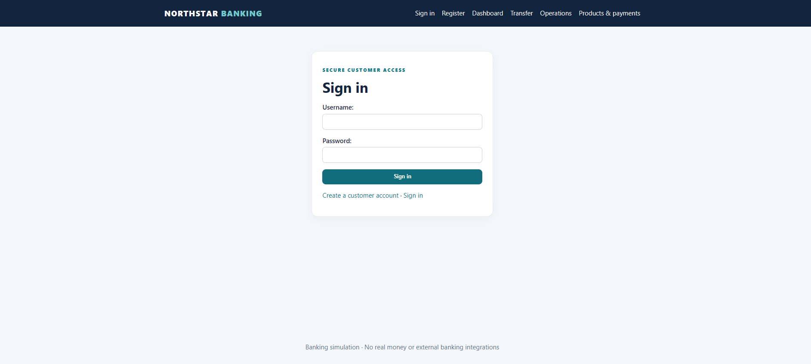
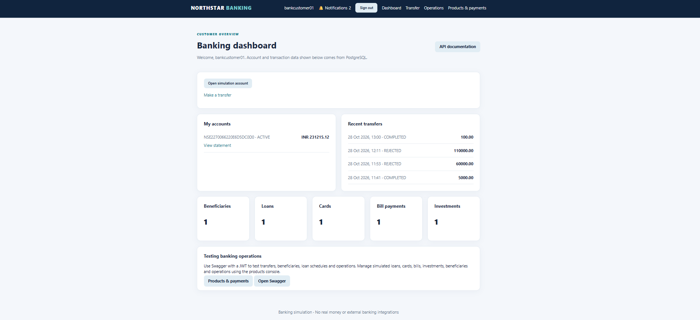
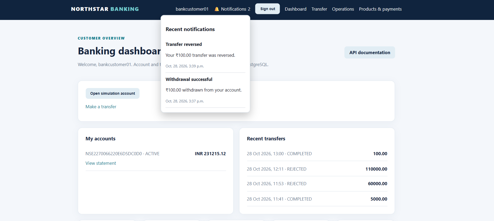
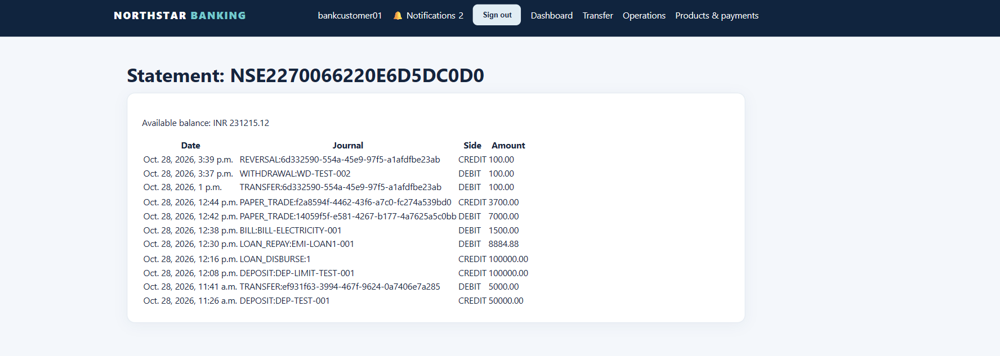
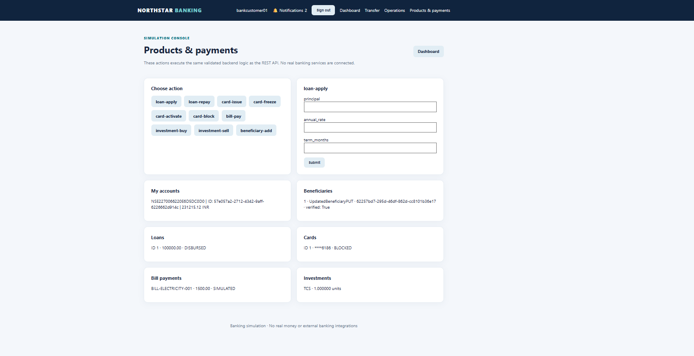
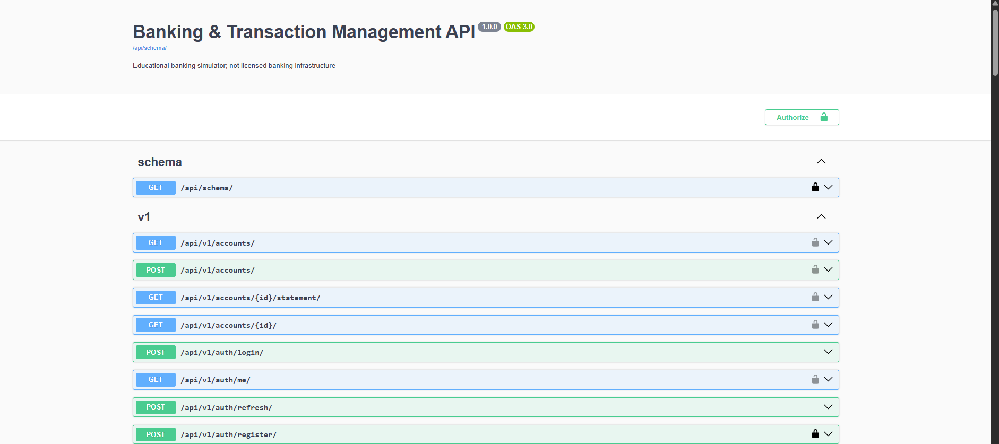
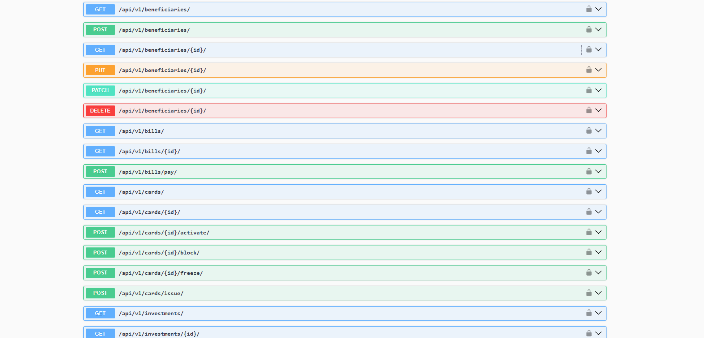
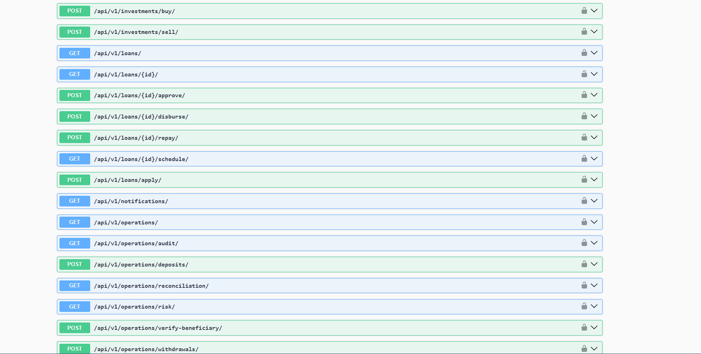
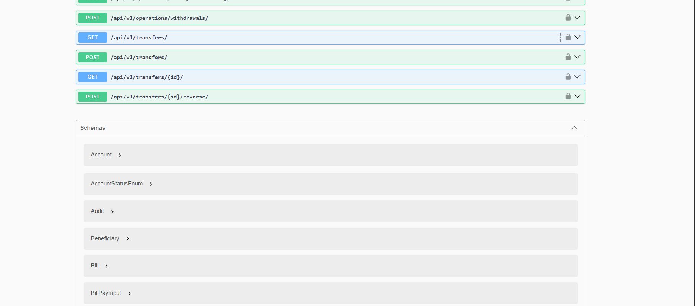

# Northstar Banking
### Banking & Transaction Management System

A full-stack banking simulation platform built with **Django, Django REST Framework, PostgreSQL, Redis, Celery, and Docker**.

Northstar Banking demonstrates backend engineering practices through transactional financial operations, double-entry ledger accounting, secure account access, idempotent payments, and role-based banking workflows. It combines RESTful APIs with a server-rendered Django Templates interface.

> **Project Type:** Advanced Backend Engineering & Full-Stack Portfolio Project  
> **Architecture:** Django REST API + Django Templates  
> **Database:** PostgreSQL  
> **Deployment:** Docker Compose (local environment)

---

## Application Screenshots

A preview of the Northstar Banking web interface.



















---

## Core Features

### Authentication & Account Management
- User registration and authentication with JWT.
- Customer and administrator access controls.
- Bank account creation and account balance management.
- Account statements and transaction history.
- Beneficiary management with verification requirements.

### Transactions & Ledger
- Account deposits and withdrawals.
- Fund transfers between eligible accounts.
- Idempotency protection against duplicate transaction processing.
- Double-entry ledger recording.
- Transaction reversal workflows with original ledger records preserved.
- Reconciliation checks for ledger consistency.

### Banking Services
- Debit card management, including activation, freezing, and blocking.
- Loan records, repayment tracking, and schedules.
- Bill payment processing.
- Simulated investment purchases, sales, and portfolio holdings.

### Operations & Monitoring
- Administrative banking operations.
- Audit event tracking.
- Risk monitoring capabilities.
- In-app notifications.
- Reconciliation and transaction monitoring.

### Reliability & Security
- PostgreSQL-backed transactional data.
- Django ORM and database constraints.
- Role-based API permissions.
- Redis and Celery integration for asynchronous processing.
- Automated regression testing with pytest.
- Security checks using Bandit and pip-audit.

---

## Technology Stack

| Layer | Technologies |
|---|---|
| Backend | Python 3.12, Django, Django REST Framework |
| Frontend | Django Templates, HTML, CSS, JavaScript |
| Database | PostgreSQL 16 |
| Authentication | JWT, Django Authentication |
| Background Processing | Celery, Redis |
| API Documentation | OpenAPI / Swagger UI |
| Testing | pytest, pytest-django, DRF APIClient |
| Containerization | Docker, Docker Compose |
| CI/CD | GitHub Actions |
| Security Analysis | Bandit, pip-audit |

---

## System Architecture

```text
                  Customer / Administrator
                            |
                            v
                    Django Templates
                            |
                            v
                   Django REST Framework
                            |
             +--------------+--------------+
             |              |              |
             v              v              v
       Authentication   Banking APIs   Operations APIs
             |              |              |
             +--------------+--------------+
                            |
                            v
                        Django ORM
                            |
                            v
                       PostgreSQL

                Redis <----> Celery Worker
```

The application uses a modular Django architecture, separating banking domains such as accounts, transfers, ledger, cards, loans, billing, investments, notifications, audit, and risk.

---

## Project Structure

```text
banking_platform/
├── .github/
│   └── workflows/
├── apps/
│   ├── accounts/
│   ├── audit/
│   ├── billing/
│   ├── cards/
│   ├── identity/
│   ├── investments/
│   ├── ledger/
│   ├── loans/
│   ├── notifications/
│   ├── operations/
│   ├── portal/
│   ├── risk/
│   └── transfers/
├── config/
├── docs/
│   └── images/
│       ├── snap1.png
│       ├── ...
│       └── snap9.png
├── static/
├── templates/
├── tests/
├── docker-compose.yml
├── Dockerfile
├── manage.py
├── requirements.txt
└── README.md
```

---

## Getting Started

### Prerequisites

- Docker Desktop
- Docker Compose
- Git

### 1. Clone the Repository

```bash
git clone https://github.com/saiarvindcs/Banking-And-Transaction-Management-System.git
cd Banking-And-Transaction-Management-System
```

### 2. Configure Environment Variables

Configure the environment variables required by your Django settings and Docker Compose configuration, including database credentials, Django secret key, and Redis/Celery connection settings.

Use development-only credentials for local testing. Never commit real secrets or production credentials.

### 3. Start the Application

```bash
docker compose up -d --build
```

### 4. Apply Database Migrations

```bash
docker compose exec api python manage.py migrate
```

### 5. Access the Application

| Service | URL |
|---|---|
| Banking Portal | http://localhost:8000/ |
| Login | http://localhost:8000/login/ |
| Registration | http://localhost:8000/register/ |
| Swagger API Documentation | http://localhost:8000/api/docs/ |

The application is configured for local development and demonstration.

---

## API Capabilities

The REST API is organized into domain-specific endpoints.

| Module | Capabilities |
|---|---|
| Authentication | Register, login, token refresh, user profile |
| Accounts | Create accounts, list accounts, retrieve statements |
| Beneficiaries | Register and manage beneficiaries |
| Transfers | Initiate transfers and perform authorized reversals |
| Operations | Deposits, withdrawals, reconciliation |
| Cards | Card lifecycle management |
| Loans | Loan information and repayment operations |
| Billing | Bill payment processing |
| Investments | Simulated buy/sell operations and holdings |
| Notifications | User-specific notification retrieval |
| Audit & Risk | Administrative monitoring |

Explore the available endpoints, request schemas, authentication requirements, and responses using Swagger UI.

---

## Automated Testing

The project includes regression tests for important financial operations and access-control rules.

Test coverage includes:

- Deposit and withdrawal idempotency.
- Transfer execution and ledger balancing.
- Transaction reversals and ledger immutability.
- Customer account ownership restrictions.
- Card lifecycle restrictions.
- Bill payments and simulated investments.
- Account statements.
- Notification privacy.
- Password validation.
- Reconciliation.

Run the test suite:

```bash
docker compose exec api pytest -q
```

**Latest locally verified result: 17 tests passed.**

GitHub Actions also runs automated checks for migrations, application configuration, tests, and security analysis.

---

## Banking Integrity & Security

Financial operations are designed around several important backend principles:

**Idempotency:** Repeated requests using the same operation reference or idempotency key should not duplicate a financial transaction.

**Double-entry accounting:** Financial movements are recorded through balancing ledger entries to support consistency checks.

**Authorization:** Customers can access and operate on permitted resources, while sensitive administrative operations require elevated privileges.

**Transaction reversals:** Reversal operations preserve original transaction records and create compensating accounting entries.

**Auditability:** Administrative and financial activity can be tracked through audit and operational records.

This project is a banking simulation and has not been independently audited or certified for handling real customer funds.

---

## CI/CD

The repository includes a GitHub Actions workflow for:

- Python dependency installation.
- PostgreSQL and Redis service initialization.
- Django system checks.
- Migration consistency checks.
- Automated pytest execution.
- Bandit security scanning.
- Python dependency vulnerability auditing.

The workflow is intended to help identify regressions before changes are merged.

---

## Project Scope

Northstar Banking is an educational and portfolio-focused banking simulation designed to demonstrate backend development, financial transaction modeling, API security, database integrity, automated testing, and containerized application workflows.

It does not connect to real banking networks, process actual customer funds, or provide regulated financial services.

---

## License

This project is licensed under the **MIT License**. See the [LICENSE](LICENSE) file for details.

---

Built with Python, Django, PostgreSQL, and a focus on reliable backend engineering.


---

## Author

**CS Sai Aravind**

Backend Developer | Python • Django • Django REST Framework • PostgreSQL

**GitHub:** [saiarvindcs](https://github.com/saiarvindcs)

---

© 2026 CS Sai Aravind. Licensed under the MIT License.
